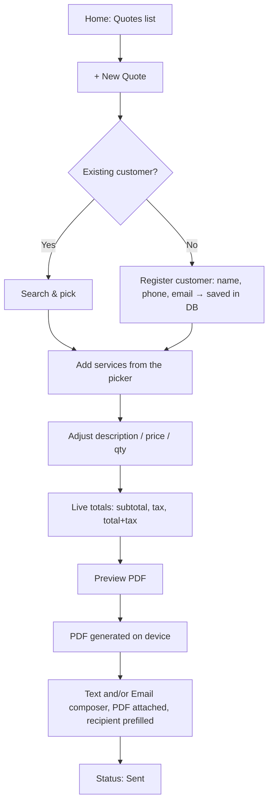
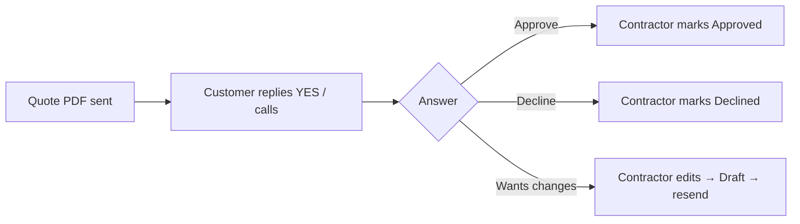
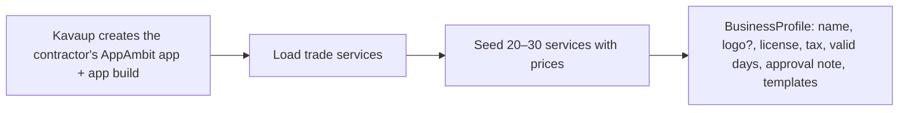
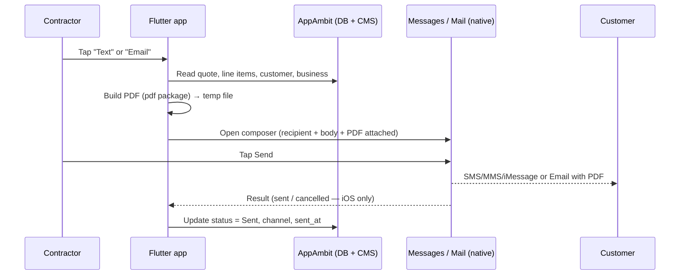
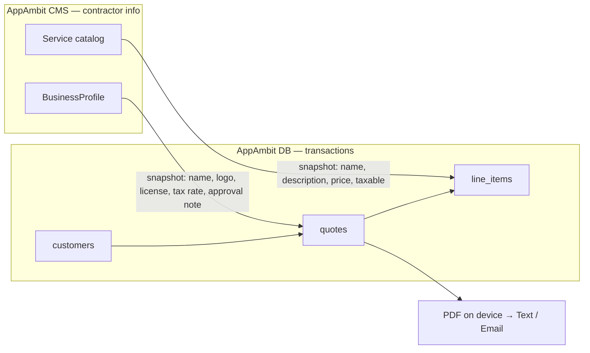

# PRD — Contractor Quote App — **Quotesheaf**

| Field | Value |
|---|---|
| Doc type | Product Requirements Document (MVP) |
| Status | **v1.2 — Quotes only** (no invoices, no conversion, no Catalog screen, no inventory) |
| Date | 2026-09-23 |
| Owner | Kavaup — Marketing / Product |
| Model | **One dedicated app per contractor** (white-label): same Flutter codebase, a separate build + separate AppAmbit app for each contractor |
| Platform | **Flutter** — **demo on iOS only** (Android later) + **AppAmbit** (`appambit_sdk`: CMS read, database, analytics, crash reporting) |
| Reference customer | Czanelle's Airconditioning & Refrigeration — HVAC, 3534 Likini St, Honolulu, HI |

### Changelog v1.2 (from v1.1)
| Change | Why | Sections touched |
|---|---|---|
| **Invoices removed.** The app only creates and sends **quotes**. No "Convert to invoice", no invoice PDF, no "Mark paid". | Keep the product focused on the moment that wins the job: quoting on-site. | §1, §3, §5.1–5.5, §6, §7, §9, §10, §13, §14 |
| Quote life cycle ends at **Approved / Declined**. Statuses `Invoiced`, `Paid`, `Overdue` removed. | Nothing happens after approval inside the app. | §5.1, §5.3, §9.2 |
| **No Catalog screen.** The service catalog stays in the CMS and is used **only** by the service picker inside the quote editor. | The CMS can't be edited from the app, and the end customer never uses the app, so a Catalog screen would only duplicate the picker. | §5.6, §7 |
| **Inventory removed** (stock counts, low stock, adjust stock, stock decrement). | Stock used to decrease when an invoice was marked Paid; with no invoices there is no reliable moment to decrease it (an approved quote doesn't guarantee the job was done). | §5.7 (removed), §9, §10 |
| **Payment methods ("How to pay") removed from the demo.** The quote PDF footer shows **"How to approve"** instead. | They only made sense on an invoice. Moved to open questions. | §5.5, §9.1, §15 |
| `due_days` → **`valid_days`** (quote validity). New optional `approval_note`. | A quote has a validity date, not a due date. | §5.2, §5.9, §9.1 |
| DB table `documents` → **`quotes`**; tables `inventory` and invoice counter removed. | Only one document type left. | §9.2 |
| Navigation: **Quotes (home) + Customers + Business (read-only)**. No Invoices or Catalog tabs. | Only two things the contractor manages in the app. | §5.1, §7 |

---

## 1. Summary

A mobile-first app that lets a small contractor (HVAC, plumbing, electrical, handyman, cleaning, landscaping…) **build a quote on-site in under 2 minutes and send it to the customer by text message and/or email** as a **PDF attachment** generated on the phone (no link, no customer app needed). The contractor then records whether the customer **approved or declined** it.

The contractor's services and prices live in the **CMS** (set up once), so line items are **picked, not typed**.

**Product model — one app per contractor.** Kavaup sells the same app to many contractors, but **each contractor gets their own dedicated app**, tailored to their trade:
- **Own app build:** app name and icon of the contractor (e.g., "Czanelle's"), published for that contractor.
- **Own AppAmbit app:** its own CMS (business profile, logo, services for their trade) and its own database (their customers and quotes). No data is shared between contractors, so no multi-tenant logic is needed.
- **Dedicated to the trade:** the service catalog, units and wording are set up for that contractor's type of work (the demo is A/C & refrigeration).
- **Same code for everyone:** only configuration changes (AppAmbit app key, app name, icon, CMS content).

Czanelle's Airconditioning & Refrigeration (Honolulu) is the first demo app.

## 2. Problem

- Small contractors quote on paper, in Notes, or in a text message.
- Quotes are slow to send, so customers call the next contractor.
- Prices are inconsistent because there is no saved price list.
- Tools like QuickBooks, Jobber, Housecall Pro are powerful but heavy and priced for larger crews.

## 3. Goals & success metrics

| Goal | Metric (MVP target) |
|---|---|
| Fast quoting | Median time from "New quote" to "Sent" ≤ 2 min |
| Send success | ≥ 95% of "Text"/"Email" taps end in a sent message with the PDF attached |
| Outcome tracked | ≥ 70% of sent quotes are marked Approved or Declined by the contractor |
| Onboarding | New contractor sends first quote within 10 min of receiving the app |

**Non-goals (MVP):** invoicing, payment tracking, inventory/stock, scheduling/dispatch, payroll, accounting, multi-crew GPS tracking, customer portal with login.

## 4. Users / personas

1. **Owner-operator (primary)** — e.g., the HVAC tech at Czanelle's. On a phone, in a customer's garage, one hand free. Needs big buttons, saved services, one-tap send.
2. **Contractor in the AppAmbit dashboard** — manages the business profile, services and prices in the CMS (Kavaup does the first setup).
3. **End customer (recipient)** — receives the PDF attached to a text message or email and opens it on their phone. No app, no link, no login. Approves by replying or calling.
4. **Kavaup (builder)** — for each new contractor: creates their AppAmbit app, loads the initial CMS content (profile, logo, trade services), builds and publishes their dedicated app.

### Reference persona — Czanelle's Airconditioning & Refrigeration (Honolulu)
- Category: Heating & Air Conditioning / HVAC; ~36 Yelp reviews, 113 photos.
- Typical line items: service call / diagnostic fee, labor (hourly), refrigerant (per lb), capacitors, contactors, filters, mini-split install, duct cleaning, maintenance plan.
- Tax: Hawaii **General Excise Tax (GET)**. Oahu rate = **4.5%** (4% state + 0.5% county surcharge). Businesses may pass on up to **~4.712%**, because GET is charged on gross receipts. **Demo uses 4.5%**; the rate is data in the CMS (`BusinessProfile.tax_rate`) and each contractor can change it.

## 5. Scope — features

### 5.1 Home — Quotes list (F-01)
- List of quotes **grouped/sorted by customer name** (option: most recent first).
- Each row: customer name, quote number (#Q-0038), total (incl. tax), status, date.
- Status: `Draft` · `Sent` · `Approved` · `Declined`.
- Search by customer name / phone / quote number; filter by status.
- Primary action: **+ New Quote**.
- Navigation: **Quotes** (home) · **Customers** · **Business** (read-only settings). No Invoices or Catalog screens.

### 5.2 Create / edit quote (F-02)
- **Customer** (required): pick a **registered customer** from the AppAmbit DB, or tap **"+ Register customer"** inline (saved to the DB first, then used in the quote). At least one contact is required: phone (for Text) and/or email (for Email).
- **Line items** (repeatable), added from the **service picker** (§5.6):
  - Service (picked from the CMS catalog)
  - Description (prefilled from catalog, editable)
  - Price (unit price, prefilled, editable)
  - Quantity
  - Line total = price × quantity (auto)
  - Taxable toggle (default from catalog)
- **Totals block** (live): Subtotal · Tax (rate × taxable subtotal, label e.g. "GET 4.5%") · **Total + tax**.
- **Valid until** = issue date + `BusinessProfile.valid_days` (shown on the PDF).
- Actions: **Save draft**, **Preview**, **Send**.
- Editing a **Sent** quote is allowed: it keeps its number, goes back to `Draft`, and must be sent again.
- Later (v1.1): photos, discounts, notes.

### 5.3 Quote status — Approved / Declined (F-03)
- The customer answers outside the app (replies "YES" to the text, or calls). The contractor records the answer in the quote detail: **Mark approved** or **Mark declined** (saves `approved_at` / `declined_at`).
- A decided quote can be changed back (undo) in case of a mistake.
- Quote detail also shows how and when it was sent (`sent_via`, `sent_at`) and offers **Resend** (Text / Email) and **Edit**.
- **No conversion to invoice.** Approved is the final state in the app.

### 5.4 Send quote as PDF via Text and/or Email (F-04)
The customer **does not need the app, a link, or an account**: they receive the PDF as an attachment in their Messages app or inbox.

- Recipients come from the **registered customer in the AppAmbit DB** (phone and email), so they are **always prefilled**.
- On the preview screen, **exactly two buttons** (no generic share sheet):
  - **📱 Text** → opens the native Messages composer with: recipient = customer phone, body = message template, attachment = PDF.
  - **✉️ Email** → opens the native Mail composer with: to = customer email, subject, body, attachment = PDF.
- Default message template (editable, stored in the contractor's CMS profile):
  > "Hi {{first_name}}, here's your quote {{number}} from {{business}} for {{total}}. PDF attached. Reply YES to approve or call {{business_phone}}."
- The contractor taps **Send** inside Messages/Mail (the OS does not allow apps to send silently).
- After returning to the app, the quote is updated in the DB: status **Sent**, `sent_via`, `sent_at` (iOS reports sent / cancelled / failed, so status is set only when the message was actually sent).
- **Text** is disabled if the customer has no phone or the device can't send texts/attachments; **Email** is disabled if the customer has no email or no mail account is configured. The disabled button shows why ("Add a phone number to this customer").

### 5.5 PDF generation on device (F-05)
- The PDF is generated **inside the Flutter app** from the quote data (no server, no hosting, no public URL).
- Packages: [`pdf`](https://pub.dev/packages/pdf) (v3.13) to build the layout + [`printing`](https://pub.dev/packages/printing) (v5.15, `PdfPreview`) for the on-screen preview + `path_provider` (temp folder).
- Layout: Letter size, design in §5.5.1.
- File name: `{Business}_Quote_Q-0038.pdf`, saved to the app's temp folder; regenerated whenever the quote changes.
- Target: generation < 1 s on a mid-range phone; file size < 300 KB (compress logo) so it goes through MMS.
- Preview screen shows exactly the PDF that will be sent.
- `PdfPreview` configured with `allowSharing: false`, `allowPrinting: false`, `canChangePageFormat: false`, `canChangeOrientation: false`, `canDebug: false` — the only actions are **Text** and **Email**.
- Bundle the **Poppins** TTF files (Light, Regular, Medium, Bold) as assets; cache the logo from the CMS locally.

### 5.5.1 PDF design spec — Quote
Layout reference: **`invoice-preferred-with-logo.pdf`** / **`invoice-preferred-no-logo.pdf`** (same folder). The layout is reused with the quote wording below.

**Design principles**
1. **Every element has a job**; contractor info only where it adds value.
2. **Neutral:** black, zinc greys, white. The logo (if any) is the only color.
3. **Nothing repeated:** business name, quote number, total and valid-until date appear once.
4. **No logo → no logo:** no placeholder; the business name starts at the left edge.
5. **Compact header:** quote number right under the "Quote" title; Issued / Valid until as two small lines below it.
6. **"How to approve" in the footer.**
7. The contractor only types **customer, services, quantities**.

**Palette & type (fixed)**: Ink `#18181B` · Muted `#71717A` · Rule `#E4E4E7` · Poppins Light / Regular / Medium / Bold (bundled TTF).

**Layout (top to bottom)**
```
┌───────────────────────────────────────────────────────────┐
│ [logo?] Business name                          Quote      │
│         Trade                                   #Q-0038   │
│         Phone · Email               Issued Sep 23, 2026   │
│                                    Valid until Oct 7, 2026│
├───────────────────────────────────────────────────────────┤
│ BILL TO  Name / address / phone · email                   │
│ SERVICE ............................ QTY  PRICE  AMOUNT   │
│ Name + description ................. 1 ea $129   $129     │
│                                   Subtotal        $650.50 │
│                                   GET 4.5%         $29.27 │
│                                   ─────────────────────── │
│                                   Estimated total $679.77 │
├───────────────────────────────────────────────────────────┤
│ HOW TO APPROVE  Reply YES to this text or call (808) …    │
│ Address · HI Contractor License #             Page 1 of 1 │
└───────────────────────────────────────────────────────────┘
```

**Flutter `pdf` implementation**
- `MultiPage`; header `Row`: left = optional `Image` (50×50pt, `BoxFit.contain`) + business `Column`; right = `Column(crossAxisAlignment: end)` with "Quote" (Light 28pt), "#Q-0038" (Medium 11pt), "Issued …" / "Valid until …" (7.8pt muted, valid-until in ink).
- `Divider(thickness: 1, color: ink)` then Bill to.
- Items: `Table` with bottom hairlines; header repeats on page 2.
- Totals: right-aligned `Column` (3in), top border before "Estimated total" (Bold 20pt).
- `footer:` callback → "How to approve" row only on the last page; legal line + "Page X of Y" on every page.

### 5.5.2 Quote data — where every value comes from and how
**Rule:** the **CMS** holds the contractor's information (set once), the **DB** holds what is created every day (customers, quotes, line items), and **calculations** happen in the app. When a quote is saved, everything from the CMS that is printed is **copied (snapshot) into the DB**, so a sent quote never changes if the contractor later edits a price or their address.

| # | Quote element | Source | Field(s) | Who feeds it · when | How it gets to the PDF |
|---|---|---|---|---|---|
| 1 | Logo (optional) | CMS `BusinessProfile` | `logo` | Kavaup at setup / contractor later | Downloaded once and cached; if empty, not shown |
| 2 | Business name, trade | CMS `BusinessProfile` | `name`, `trade_label` | Onboarding | Snapshot → `quotes.business_snapshot` |
| 3 | Business phone · email | CMS `BusinessProfile` | `phone`, `email` | Onboarding | Snapshot |
| 4 | "Quote" title | Fixed | — | App | "Quote" |
| 5 | Quote number #Q-0038 | DB `quotes` | `number` | **Auto** — next number from DB `counters` in a transaction (`AppAmbitDb.batchInTransaction`) | Read from DB |
| 6 | Issued date | DB `quotes` | `issue_date` | **Auto** — today | Read from DB |
| 7 | Valid until | DB `quotes` | `valid_until` | **Auto** — `issue_date + BusinessProfile.valid_days` | Read from DB |
| 8 | Bill to: name, address, phone, email | DB `customers` | `name`, `address`, `phone`, `email` | **Contractor** · once, when registering the customer | Joined by `quotes.customer_id` |
| 9 | Service name + description | CMS `Service` → DB `line_items` | `name`, `description` | Catalog: onboarding · per quote: **contractor picks the service** (description editable) | Copied into `line_items` |
| 10 | Qty + unit | DB `line_items` (unit from CMS `Service.unit`) | `quantity`, `unit` | **Contractor** types the quantity | Read from DB |
| 11 | Price | CMS `Service.unit_price` → DB `line_items` | `unit_price` | Catalog price, editable per line | Copied into `line_items` |
| 12 | Amount | Calculated | `line_total = round(unit_price × quantity)` | **Auto** | `line_items.line_total` |
| 13 | Subtotal | Calculated | sum of `line_total` | **Auto** | `quotes.subtotal` |
| 14 | Tax label · rate · name | CMS `BusinessProfile` → DB `quotes` | `tax_label`, `tax_rate`, `tax_name` | Onboarding (e.g., "GET", 4.5%) | Snapshot |
| 15 | Tax amount | Calculated | `round(taxable subtotal × tax_rate)` | **Auto** | `quotes.tax_amount` |
| 16 | Estimated total | Calculated | `subtotal + tax_amount` | **Auto** | `quotes.total` |
| 17 | How to approve | CMS `BusinessProfile` | `approval_note` (default "Reply YES to this text or call {business_phone}.") | Onboarding | Snapshot |
| 18 | Address · license # | CMS `BusinessProfile` | `address`, `license_no` | Onboarding | Snapshot |
| 19 | Page X of Y | `pdf` package | `context.pageNumber / pagesCount` | **Auto** | Footer |

**What the contractor actually types per quote:** pick the **customer** (#8), pick **services** (#9) and enter **quantities** (#10). Everything else is automatic or comes from the CMS.

**Generation flow (in the Flutter app):**
1. Contractor taps **New Quote** → app runs `AppAmbitDb.batchInTransaction([UPDATE counters SET value = value + 1 WHERE name = 'quote', SELECT value FROM counters WHERE name = 'quote'])` → gets `Q-0038`; sets `issue_date` = today, `valid_until` = today + `valid_days`.
2. App reads `BusinessProfile` from the CMS and stores the snapshot fields in `quotes`.
3. Line items are saved in `line_items`; subtotal, tax and total are calculated in the app (integer cents) and saved in `quotes`.
4. On **Preview / Text / Email**, the app loads quote + customer + line items from the DB and builds the PDF (fonts bundled, logo from cache).
5. PDF saved to the temp folder → attached to the Messages / Mail composer → after sending, `status = sent`, `sent_via`, `sent_at` updated in the DB.

### 5.6 Service catalog — CMS data, no screen (F-06)
- Services live in the **AppAmbit CMS** (content type `Service`): name, SKU (optional), category, description, unit (ea, hr, lb, ft), unit price, taxable Y/N, active Y/N.
- Managed by the **contractor in the AppAmbit dashboard** (Kavaup does the initial setup). **Read-only from the app.**
- **There is no Catalog screen.** The catalog is used only by the **service picker** in the quote editor: search, filter by category, recent services, tap to add. Only `active` services are shown.
- Each contractor's app is seeded with the typical services of **their** trade.

#### 5.6.1 Demo seed catalog — Czanelle's Airconditioning & Refrigeration
Czanelle's real service list and prices could not be retrieved (Yelp blocks automated access). The catalog below uses **service names typical of Honolulu A/C & refrigeration shops**, with **sample prices** the contractor adjusts in the CMS.

| # | Service (CMS `name`) | Unit | Sample price | Taxable |
|---|---|---|---|---|
| 1 | AC Diagnostic / Service Call | ea | $129.00 | Yes |
| 2 | Split / Ductless AC Repair — Labor | hr | $125.00 | Yes |
| 3 | Window AC Repair | ea | $95.00 | Yes |
| 4 | Split AC Cleaning & Maintenance (per indoor unit) | ea | $149.00 | Yes |
| 5 | Central AC Maintenance | ea | $189.00 | Yes |
| 6 | Ductless Mini-Split Installation (up to 12k BTU) — Labor | ea | $1,450.00 | Yes |
| 7 | Refrigerant Leak Search | ea | $175.00 | Yes |
| 8 | Refrigerant Recharge R-410A | lb | $85.00 | Yes |
| 9 | Refrigerant Recharge R-32 | lb | $75.00 | Yes |
| 10 | Condensate Drain Line Flush | ea | $75.00 | Yes |
| 11 | Commercial Refrigeration Service Call | ea | $165.00 | Yes |
| 12 | Walk-in Cooler / Freezer Repair — Labor | hr | $145.00 | Yes |
| 13 | Reach-in Refrigerator / Freezer Repair — Labor | hr | $135.00 | Yes |
| 14 | Ice Machine Cleaning & Sanitizing | ea | $225.00 | Yes |
| 15 | Emergency / After-Hours Call | ea | $195.00 | Yes |
| 16 | Dual Run Capacitor 45/5 µF | ea | $89.00 | Yes |
| 17 | Contactor 30A | ea | $79.00 | Yes |
| 18 | Condenser Fan Motor | ea | $285.00 | Yes |
| 19 | Air Filter (split unit) | ea | $25.00 | Yes |
| 20 | Programmable Thermostat | ea | $165.00 | Yes |

The sample quote Q-0038 uses items 1, 16, 8, 2 and 10 (subtotal $650.50 · GET 4.5% $29.27 · total $679.77).

### 5.7 ~~Inventory~~ — removed in v1.2
No stock counts, low-stock alerts or stock adjustments. See §15 if it comes back.

### 5.8 Customers — registration (DB) (F-08)
- The contractor **registers each customer** before (or while) creating a quote; this is what enables sending.
- Fields: name *(required)*, phone, email *(at least one required)*, address, notes (internal, not printed).
- Validation: phone in E.164 format (e.g., +18085551234), valid email format; warn on duplicates (same phone or email).
- Stored in the **AppAmbit DB** (`customers`).
- **Customers screen:** list (search by name / phone / email, A–Z) + **Register customer**.
- **Customer detail:** contact info (edit), internal note, all their quotes with status, **New quote for this customer**.

### 5.9 Business profile (CMS) (F-09)
- The contractor's information lives in the **AppAmbit CMS** (content type `BusinessProfile`): business name, trade, logo (optional), license # (important in HI), address, phone, email, tax label + rate + name (e.g., "GET" 4.5% "Hawaii General Excise Tax"), quote number prefix, `valid_days`, `approval_note`, SMS/email message templates.
- Shown read-only in the app's **Business** screen (edited in the AppAmbit dashboard).

## 6. Key user flows

### Flow A — Create & send quote (happy path, on-site)


### Flow B — Customer answer


### Flow C — Contractor setup in AppAmbit CMS


### Flow D — Sending pipeline (on device)


## 7. Screens (MVP)

1. *(No login screen.)* AppAmbit has **no end-user login**; the app is dedicated to one contractor and **distributed privately** (TestFlight / AppAmbit build distribution), so it opens straight to Home. Optional Face ID lock with `local_auth` in v1.1.
2. **Home — Quotes list** (by customer name, search, status filter, **+ New Quote**)
3. **Quote editor** (customer, line items, live totals, valid until)
4. **Customer picker + Register customer** form
5. **Service picker** (services from CMS: search, categories, recent) — *this is the only place the catalog appears*
6. **PDF preview** with **📱 Text** and **✉️ Email** buttons
7. **Quote detail** (sent info, **Mark approved / Mark declined**, Resend, Edit)
8. **Customers list**
9. **Customer detail** (contact, note, quote history, New quote)
10. **Business** (profile from CMS, read-only)

## 8. Decision — how the quote is delivered

### 8.1 Final decision for the demo
**Generate the PDF on the phone (Flutter) and send it as an attachment through the native Messages and Mail composers, with the customer's phone/email prefilled.**

### 8.2 Options evaluated
| Option | Verdict | Why |
|---|---|---|
| HTML page served by an AppAmbit Cloud Code function | ❌ Discarded | HTTP triggers require `Authorization: Bearer {consumer token}`; a customer opening a link from SMS has no token → 401. |
| Deep link into the app | ❌ Discarded | The customer doesn't have the app. |
| Own domain / web proxy (Vercel, Cloudflare) serving HTML | ⏸ Later | Works (tracking, online "Approve" button) but adds a web service to maintain. |
| PDF uploaded to public storage (Firebase/R2) + link in SMS | ⏸ Later | Real link on any SMS, but adds another service and long URLs. |
| **PDF on device + native Messages/Mail composers** | ✅ **Chosen** | Zero backend for delivery, no domain, no tokens, everything inside the Flutter + AppAmbit app. |

### 8.3 Trade-offs accepted for the demo
- **No "Viewed" tracking** and no "Approve" button for the customer (status is updated manually by the contractor: Approved / Declined).
- **Demo is iOS only.** On iPhone the PDF goes via iMessage (or MMS to non-iPhones); keep PDF < 300 KB.
- The contractor must tap **Send** in the native composer (OS rule).

### 8.4 Flutter implementation notes
- **No share sheet (`share_plus` not used):** it can't be limited to SMS + Email and can't prefill the recipient. Only the two dedicated composers.
- **Email:** [`flutter_email_sender`](https://pub.dev/packages/flutter_email_sender) — recipients, subject, body, attachments (Mail composer). Handle "no mail account configured" on iOS.
- **SMS with attachment:** a **small platform channel** (~60 lines; iOS only for the demo):
  - **iOS:** `MFMessageComposeViewController` → `recipients`, `body`, `addAttachmentURL(pdfURL, withAlternateFilename:)`; check `canSendText()` and `canSendAttachments()`; delegate returns sent/cancelled/failed.
  - **Android (later):** `Intent.ACTION_SEND`, type `application/pdf`, `EXTRA_STREAM` = `FileProvider` URI, extras `address` and `sms_body`, `setPackage(Telephony.Sms.getDefaultSmsPackage(ctx))`.
- Test on **real devices** (simulators can't send SMS).

## 9. Data architecture — CMS feeds the DB

**Principle:** the **CMS holds the contractor's information** (who they are and what they sell). The **DB holds the transactions** (customers and quotes). When a quote is saved, data from the CMS is **copied (snapshotted)** into the DB, so a sent quote never changes if a price or the business info is edited later.



### 9.1 CMS content types
```
-- BusinessProfile: one single entry per app
BusinessProfile(name*, logo (Media), trade_label, license_no, address, phone, email,
                tax_label, tax_rate, tax_name, quote_prefix, valid_days,
                approval_note, sms_template, email_subject, email_template)
Service(name*, sku, category, description, unit, unit_price*, taxable, active)
```

### 9.2 DB tables
```
customers(id, name*, phone, email, address, notes, created_at)
          -- at least one of phone/email required
quotes(id, number, customer_id, status[draft|sent|approved|declined],
       issue_date, valid_until,
       business_snapshot (json: name, trade_label, logo, license_no, phone, email, address, approval_note),
       tax_label, tax_rate, tax_name, subtotal, tax_amount, total,
       sent_via[sms|email], sent_at, approved_at, declined_at, created_at, updated_at)
line_items(id, quote_id, service_id?, name, description,
           unit_price, quantity, unit, taxable, line_total, sort)
counters(name PK, value)                                     -- 'quote' → next number
```

**Money rules:** store amounts in integer cents; `line_total = round(unit_price × qty)`; `tax = round(sum(taxable line_totals) × tax_rate)`; `total = subtotal + tax`.

**One app per contractor (decided):** each contractor has their own AppAmbit app (own CMS + own DB) and their own app build. Tables have no `tenant_id`.

## 10. AppAmbit mapping
| Need | AppAmbit feature |
|---|---|
| Contractor info (business profile, templates, tax, validity) | **CMS** `BusinessProfile` |
| Services catalog (for the service picker) | **CMS** `Service` |
| Registered customers | **DB** `customers` |
| Quotes, line items | **DB** `quotes`, `line_items` |
| Next quote number (Q-0038) | **App → DB transaction** on `counters` (`UPDATE … value = value + 1` then `SELECT value`) so two devices never get the same number |
| Mark approved / declined | **App → DB** `UPDATE quotes SET status = …, approved_at / declined_at = …` |
| Edit business profile, services, prices | **AppAmbit dashboard (CMS)** — by the **contractor** (Kavaup does the initial setup); the CMS cannot be edited from the app |
| Usage analytics (quote created, PDF sent via Text/Email, approved/declined) | AppAmbit events |
| Crash reporting | AppAmbit Flutter SDK (automatic) |

The app talks to AppAmbit with its own consumer token; **nothing is exposed publicly**, and the customer never touches AppAmbit.

### 10.1 Verified against the official AppAmbit docs (2026-09-23)
| PRD assumption | Official docs say | Status |
|---|---|---|
| Flutter SDK exists | Package `appambit_sdk`; init `AppAmbitSdk.start("<APP-KEY>")`; iOS 11+ | ✅ |
| App reads the CMS | `AppAmbitCms.content<T>("type", fromJson: …).getList()` with `.search()`, `.equals()`, paging | ✅ read-only |
| App can't edit the CMS | CMS REST = 5 GET endpoints; Cloud Code has `cms.list/get/publish`, no update | ✅ catalog managed in the dashboard |
| CMS supports our fields | Types: Text, Rich Text, Number, Boolean, Date, Date & Time, Email, URL, **Select**, **Media** (returned as URL), Relation, JSON | ✅ logo = Media |
| `BusinessProfile` as one record | No "singleton" type documented | ⚠️ content type with **one entry**; app reads the first entry |
| App reads/writes the DB with SQL | `AppAmbitDb.execute(sql, params)`, query builder, `AppAmbitDb.batchInTransaction([...])`; SQLite dialect | ✅ numbering + status changes from the app |
| Cloud Code callable from Flutter | `CloudCode.call('name', body: {...})` | ✅ available, not required for demo |
| Public link from Cloud Code | HTTP triggers require `Authorization: Bearer {consumer token}` | ✅ discarded (§8) |
| User login | **No end-user login**; device "consumer" tokens from the app key | ⚠️ no login screen; private distribution |
| Offline | Offline storage documented only for analytics/logs/crashes, **not for DB/CMS** | ⚠️ app needs internet to save; cache CMS locally for reading |
| Security | Any install with the app key can read/write the DB; no row-level rules documented | ⚠️ distribute each contractor's app privately for the demo |

## 11. Non-functional requirements

- **Mobile-first**, works on 4G in a customer's driveway. **Needs internet to save**; CMS data (profile, services, logo) is cached on the phone. Offline drafts — v1.1.
- Performance: quote editor interactions < 100 ms; PDF generated on device < 1 s; PDF size < 300 KB.
- Security: data isolated per contractor (separate AppAmbit app each); PDFs stored only in the app's temp folder (deleted after send); HTTPS only to AppAmbit.
- Compliance: messages are sent by the contractor from their own phone/mail app, so no A2P 10DLC registration is needed for the demo.
- Accessibility: WCAG AA contrast, 44 px tap targets.
- Localization: English first; Spanish template option (v1.1); currency USD.

## 12. Stack (decided)
- **App:** Flutter. **Demo: iOS only** (tested on a real iPhone). Android later.
- **Backend:** AppAmbit via `appambit_sdk` — CMS read-only (business profile, services), SQL database read/write (customers, quotes, line items, counters), analytics, crash reporting. Cloud Code not required for the demo.
- **Distribution (demo):** TestFlight / AppAmbit build distribution to the contractor's iPhone.
- **PDF:** `pdf` + `printing` (on device).
- **Sending:** exactly two native composers — `flutter_email_sender` for Email; custom iOS platform channel (`MFMessageComposeViewController`) for Text. No share sheet.

## 13. Release plan

| Phase | Scope |
|---|---|
| **Demo (1–2 wks)** | Flutter app on AppAmbit: register customers, quotes list by customer, quote editor with services from CMS, totals + tax, quotes saved in DB, on-device PDF, send PDF via Text / Email. Seeded with Czanelle's profile and HVAC services. |
| **MVP (3–4 wks)** | Mark approved / declined (+ undo), edit & resend, customers list + detail with quote history, Business screen, onboarding of 2–3 more contractors. |
| **v1.1** | Public quote link with online "Approve" (web proxy), photos, discounts, notes, offline drafts, Spanish. |
| **v2 (to evaluate)** | Invoicing and payments, inventory, follow-up reminders for unanswered quotes, multi-tech accounts. |

## 14. Acceptance criteria (MVP highlights)

- [ ] Home shows all quotes sorted/searchable by customer name with status (Draft / Sent / Approved / Declined); "+ New Quote" opens the editor.
- [ ] Line item row has description, price, quantity, and auto-calculated total; totals show subtotal, tax, total + tax and update live.
- [ ] A quote can't be created without a registered customer; registering a customer saves it in the AppAmbit DB.
- [ ] Services created in the CMS appear in the service picker; editing a CMS price or the business profile does not change already-saved quotes (snapshot).
- [ ] There is no Catalog, Invoices or inventory screen in the app.
- [ ] "Text" opens Messages with the customer's phone, message and the PDF attached; "Email" opens Mail with the customer's email, subject, body and the PDF attached.
- [ ] The PDF follows the quote design (§5.5.1) with and without logo, matches the preview, and its totals match the app.
- [ ] Status changes to "Sent" with channel and timestamp after sending.
- [ ] The contractor can mark a sent quote Approved or Declined, and undo it.
- [ ] Customer detail lists all quotes of that customer.

## 15. Open questions (to close before / during the demo build)

1. **Czanelle's real data:** only the business name and address (3534 Likini St, Honolulu, HI 96818) are confirmed. Logo, phone, email, HI contractor license # could not be retrieved — samples use placeholders (555 numbers, license C-00000).
2. **Hawaii GET:** demo uses **4.5%**. Later, each contractor sets their own rate (4.5% or 4.712%) and which services are taxable.
3. **AppAmbit:** test in the first build that `AppAmbitDb.batchInTransaction` returns the `SELECT` result (new counter value) in the same call; if not, run the `SELECT` right after inside the same flow.
4. **Payment methods on the quote:** should the quote PDF also show how the customer can pay (Zelle / check / cash)? Removed for now; if yes, add a `PaymentMethod` content type back.
5. **Inventory:** removed. If it returns, decide the moment stock decreases (on Approved, or on a new "Job done" status).
6. **Expired quotes:** should quotes past `valid_until` show an "Expired" label automatically?
7. **Publishing after the demo:** each contractor's app on the public App Store needs a security review first (DB is open to any install with the app key).
8. **Android:** out of scope for the demo. When added: test PDF attachment + prefilled number on Google Messages and Samsung Messages.

## 16. Sources

- Czanelle's Airconditioning & Refrigeration — Yelp: https://www.yelp.com/biz/czanelle-s-airconditioning-and-refrigeration-honolulu
- AppAmbit: https://appambit.com/ · Docs: https://docs.appambit.com/ · Flutter SDK getting started: https://docs.appambit.com/sdk-guides/getting-started/ · SDK CMS: https://docs.appambit.com/sdk-guides/cms/ · SDK Database: https://docs.appambit.com/sdk-guides/database/ · SDK Cloud Code: https://docs.appambit.com/sdk-guides/cloud-code/ · Auth: https://docs.appambit.com/Rest/authentication/ · CMS field types: https://docs.appambit.com/cms/create-content-type/ · Cloud Code limits: https://docs.appambit.com/cloud-code/configuration/ · Cloud Code triggers: https://docs.appambit.com/cloud-code/triggers/ · CMS REST endpoints (read-only): https://docs.appambit.com/Rest/cms/endpoints/
- pdf package: https://pub.dev/packages/pdf · printing: https://pub.dev/packages/printing
- flutter_email_sender: https://pub.dev/packages/flutter_email_sender · sms_mms: https://pub.dev/packages/sms_mms
- Competitors: Joist https://www.joist.com/pricing/ · Jobber https://www.getjobber.com/pricing/ · Housecall Pro https://www.housecallpro.com/pricing/ · Square Invoices https://squareup.com/us/invoices
- Twilio A2P 10DLC (why platform SMS is deferred): https://www.twilio.com/docs/messaging/compliance/a2p-10dlc
