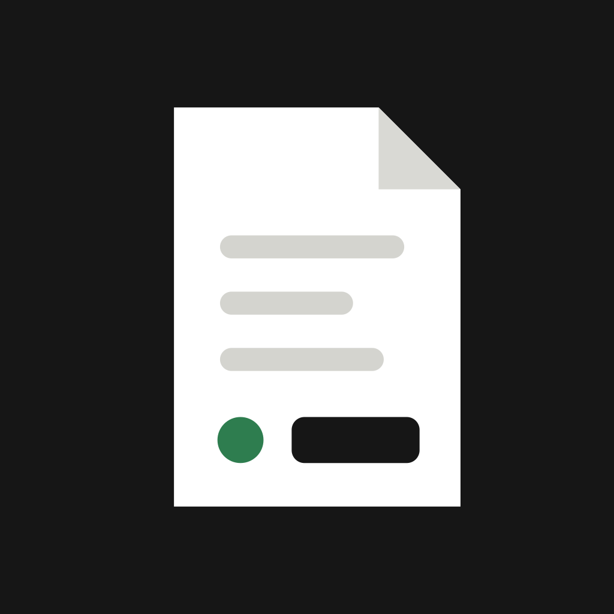
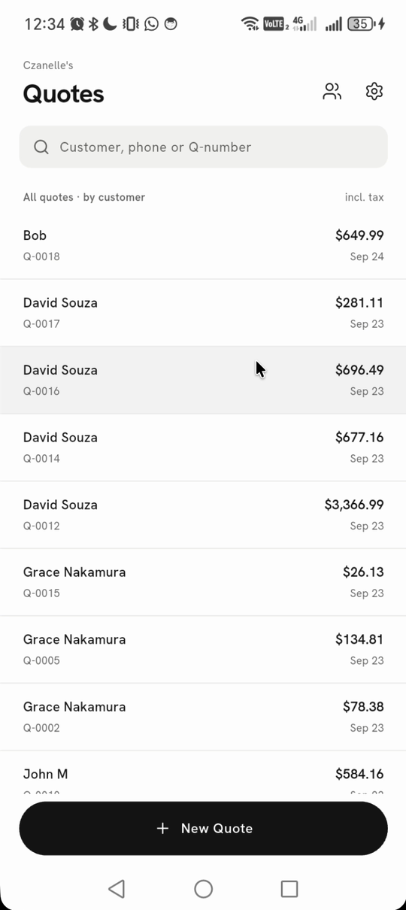
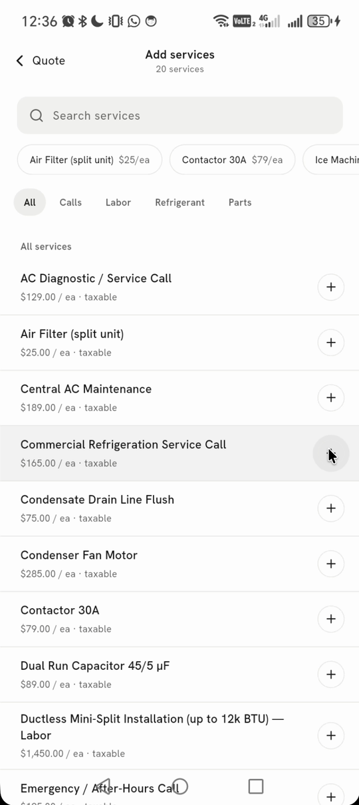
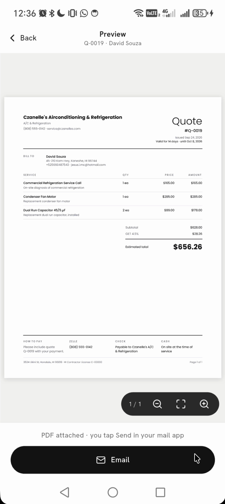

<div align="center">

<picture>
  <source media="(prefers-color-scheme: dark)" srcset="https://assets.appambit.com/logo-dark.svg">
  <source media="(prefers-color-scheme: light)" srcset="https://assets.appambit.com/logo-light.svg">
  
</picture>

<br><br>



# Quotesheaf — contractor quotes on AppAmbit (Flutter)

**Build a quote on site in under two minutes and email it to the customer as a PDF.
The business profile and the price list live in the [AppAmbit](https://appambit.com) CMS, customers and quotes in the
AppAmbit Database — no server of your own.**

App **01 / 07** of the *7 apps in 7 days* series.


[](https://www.facebook.com/profile.php?id=61583377906035)
[](https://www.instagram.com/appambit/)
[](https://www.youtube.com/@AppAmbit)

</div>

---

## Contents

- [What this is](#what-this-is)
- [Built prompt by prompt](#built-prompt-by-prompt)
- [Quick start](#quick-start)
- [Backend setup (AppAmbit)](#backend-setup-appambit)
- [How AppAmbit drives the app](#how-appambit-drives-the-app)
- [What's included](#whats-included)
- [Make it yours](#make-it-yours)
- [Project structure](#project-structure)
- [Commands](#commands)
- [Learn more](#learn-more)
- [Follow AppAmbit](#follow-appambit)

## What this is

Small contractors (HVAC, plumbing, electrical, cleaning…) quote on paper, in Notes or in a text message. Quotes go
out late and prices change from one customer to the next. **Quotesheaf** fixes that with one flow:

- **Pick, don't type.** Services, units and prices come from the contractor's catalog in the **AppAmbit CMS**, set up
  once. Line items are picked from a list.
- **Customers and quotes in the AppAmbit Database**, shared by the iOS and the Android app.
- **The PDF is made on the phone** and sent **by email** as an attachment. The customer installs nothing.
- **Numbering, tax and totals** come from the CMS, so nothing about the business is hard-coded.
- **Analytics and crash reports** go to AppAmbit.

<div align="center">

| Quotes | Add services | PDF preview |
|:---:|:---:|:---:|
|  |  |  |
| *Every quote, total with tax.* | *Services and prices from the CMS.* | *The PDF, made on the phone, ready to email.* |

</div>

> Real captures from an Android phone. Design direction **M · Mono** (black and white). Details in
> [DESIGN.md](DESIGN.md); the mockups live in [`docs/design/`](docs/design/).

## Built prompt by prompt

The whole app was built with **three prompts** sent to a coding agent (Claude Code) with the **AppAmbit MCP**
connected. They are all in **[`prompts.md`](prompts.md)**, ready to paste:

| Step | Where | What it builds |
|---|---|---|
| 0 | AppAmbit dashboard, by hand | The two AppAmbit apps (iOS and Android) and their App Keys |
| 1 | Agent + AppAmbit MCP | The database, its tables, the CMS content types and the demo content |
| 2 | Agent, Flutter | Customers, the quote editor, the service picker, numbering and totals |
| 3 | Agent, Flutter | The PDF, sending by email, analytics and tests |

## Quick start

**Prerequisites:** Flutter with Dart `^3.11`, Xcode and/or Android Studio, and an
[AppAmbit account](https://appambit.com) with **CMS** and **Database** enabled.

```bash
git clone <your fork> quotesheaf && cd quotesheaf
cp .env.example .env            # fill in your App Keys
flutter pub get
dart run build_runner build -d  # Riverpod code generation
flutter run
```

`.env` (git-ignored, never commit it):

```
APPAMBIT_IOS_APP_KEY=<your iOS app key>
APPAMBIT_IOS_CMS_SUFFIX=
APPAMBIT_ANDROID_APP_KEY=<your Android app key>
APPAMBIT_ANDROID_CMS_SUFFIX=_android
```

> CMS content type names are unique per team, so the Android app reads its own copy with the `_android` suffix.

## Backend setup (AppAmbit)

Run **prompt 1** of [`prompts.md`](prompts.md) with the AppAmbit MCP connected and the agent creates all of this.
What it ends up with:

### Database — `QuoteFlowDb`

Linked to **both** apps, so an iPhone and an Android phone see the same customers and quotes.

| Table | Holds |
|---|---|
| `customers` | Name (required), phone and email (optional) |
| `quotes` | Number, customer, dates, totals, last send (`sent_via`, `sent_at`) |
| `line_items` | The services on each quote: quantity, unit, price |
| `counters` | The next quote number |

Ids are TEXT uuids and money is INTEGER cents.

### CMS — what the contractor sells

Set once, read-only from the app:

| Content type | Used for |
|---|---|
| `business_profile` | Name, address, logo, tax, quote numbering and validity |
| `catalog_item` | The services and their prices (the **Add service** picker) |
| `service_category` | Groups in the picker |
| `unit` | Each, hour, ft… |
| `quote_footer` | The text at the bottom of the PDF |
| `payment_method` | The "How to pay" lines in the PDF footer |

## How AppAmbit drives the app

```
AppAmbit CMS (read-only) ──► business profile, tax, numbering ──► Business screen + PDF header
        │
        └──► catalog_item / category / unit ──► Add service picker ──► line items
                                                                         │
AppAmbit Database ◄── customers · quotes · line_items · counters ◄───────┘
        │
        └──► Quotes list ──► Preview (PDF made on the phone) ──► Email with the PDF attached
                                                                         │
                                              AppAmbit Analytics + crash reports
```

## What's included

| Area | Where |
|---|---|
| Quotes list, editor, detail and PDF preview | `lib/features/quotes/` |
| Customers list, detail, form and picker | `lib/features/customers/` |
| Service picker from the CMS catalog | `lib/features/services/` |
| Business profile (read-only) | `lib/features/business/` |
| AppAmbit Database and CMS clients | `lib/core/services/appambit_db.dart`, `appambit_cms.dart` |
| PDF and email | `lib/core/services/pdf_service.dart`, `email_composer.dart` |
| Analytics events | `lib/core/services/analytics.dart` |
| Money in cents, formatters, validators | `lib/core/utils/` |

## Make it yours

Quotesheaf is built as **one app per contractor**: same code, a separate build and a separate AppAmbit app for each one.

- **App keys** — your own, in `.env`.
- **Your business** — change the CMS content (profile, logo, catalog, units). No code change needed.
- **App name** — `ios/Runner/Info.plist` (`CFBundleDisplayName`) and `android/app/src/main/AndroidManifest.xml`
  (`android:label`).
- **Bundle id / applicationId** — `com.kavaup.quotesheaf` (`android/app/build.gradle.kts`, Xcode).
- **Icon** — replace `assets/icon/icon.png` and run `dart run flutter_launcher_icons`.

## Project structure

```
lib/
  main.dart              # .env → AppAmbitSdk.start → runApp
  app.dart
  core/
    router/              # go_router
    theme/               # Mono tokens: colors, spacing, text
    services/            # AppAmbit DB + CMS, PDF, email, analytics
    widgets/             # buttons, lists, sheets, inputs, states
    utils/               # money, formatters, validators
  features/<feature>/    # data/ · viewmodels/ · views/ · widgets/
test/                    # unit and widget tests
```

## Commands

| Command | Does |
|---|---|
| `flutter pub get` | Install dependencies |
| `dart run build_runner watch -d` | Riverpod code generation |
| `flutter run` | Run on a device or simulator |
| `flutter analyze` | Lint |
| `flutter test` | All tests |
| `dart run flutter_launcher_icons` | Regenerate the app icon |

## Learn more

- [prompts.md](prompts.md) — the three prompts the app was built with
- [PRD.md](PRD.md) — product rules, data model and the PDF spec
- [DESIGN.md](DESIGN.md) — the look
- [AGENTS.md](AGENTS.md) — rules for coding agents
- [AppAmbit](https://appambit.com) · [AppAmbit docs](https://docs.appambit.com) · [Flutter docs](https://docs.flutter.dev)

## Follow AppAmbit

New apps every week, built on AppAmbit with an AI agent:

- **Facebook** — [facebook.com/AppAmbit](https://www.facebook.com/profile.php?id=61583377906035)
- **Instagram** — [@appambit](https://www.instagram.com/appambit/)
- **YouTube** — [@AppAmbit](https://www.youtube.com/@AppAmbit)

---

<div align="center"><sub>Built with Flutter + AppAmbit. Swap the App Keys and it's yours.</sub></div>
